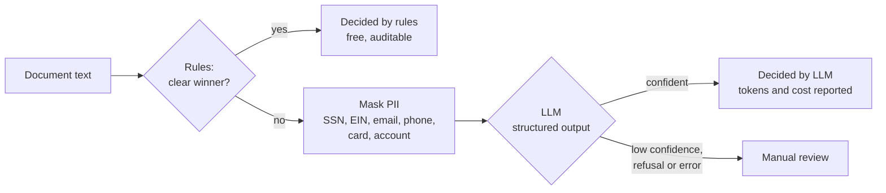
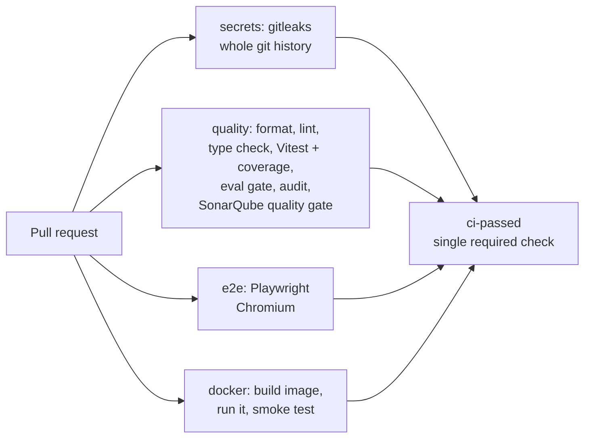

# doc-triage

A small TypeScript service (Node + React) that classifies documents from mortgage
applications (pay stubs, bank statements, W-2s, utility bills) **with rules first and an LLM
only when the rules are unsure, sending the LLM nothing but PII-masked text**.

It re-implements, with synthetic data and none of my employer's code, a pattern I built in
production: cheap deterministic rules for the easy majority, an LLM fallback for the rest,
and an evaluation CLI that measures accuracy and cost on a labeled dataset before a change ships.

## How a document flows



The response always says **which route decided and why**. When the LLM was called, it
includes the exact masked text that left the process, its token usage and its cost.

## What's automated

| Concern                   | How it's enforced                                                                   | Where                                                                                                          |
| ------------------------- | ----------------------------------------------------------------------------------- | -------------------------------------------------------------------------------------------------------------- |
| Package boundaries        | ESLint blocks `core` from importing frameworks, SDKs or Node I/O                    | [`eslint.config.mjs`](eslint.config.mjs), [ADR 1](docs/adr/0001-pure-core-with-enforced-boundaries.md)         |
| Type safety               | `strict`, `noUncheckedIndexedAccess`, `exactOptionalPropertyTypes`, type-aware lint | [`tsconfig.base.json`](tsconfig.base.json)                                                                     |
| PII never reaches the LLM | Unit test asserts what the LLM port receives; E2E checks it in the browser          | [`pipeline.test.ts`](packages/core/test/pipeline.test.ts), [`classify.spec.ts`](e2e/classify.spec.ts)          |
| Rule regressions          | CI eval gate: any misclassification by the rules fails the build                    | [`eval.ts`](apps/api/src/eval.ts), [ADR 4](docs/adr/0004-offline-by-default-and-an-eval-gate.md)               |
| API contract              | Zod validation, RFC 9457 problem details, shared TypeScript types with the UI       | [`app.ts`](apps/api/src/app.ts)                                                                                |
| Wiring                    | Playwright against the production-shaped server                                     | [`playwright.config.ts`](playwright.config.ts)                                                                 |
| Container                 | Image built and smoke-tested in CI                                                  | [`Dockerfile`](Dockerfile), [`ci.yml`](.github/workflows/ci.yml)                                               |
| Dependencies              | Lock file, `npm ci`, runtime `npm audit`, Dependabot                                | [`dependabot.yml`](.github/dependabot.yml)                                                                     |
| Code quality and coverage | SonarQube Cloud quality gate on every PR; Vitest coverage floor (80% lines)         | [`sonar-project.properties`](sonar-project.properties), [ADR 7](docs/adr/0007-sonarqube-cloud-quality-gate.md) |
| Leaked keys               | gitleaks scans every commit in the history; a finding blocks the merge              | [`ci.yml`](.github/workflows/ci.yml), [ADR 8](docs/adr/0008-secret-scanning-of-git-history.md)                 |

## Pipeline



## Architecture

```
packages/core/   pure domain: rules, PII masking, pipeline, pricing, the LlmClassifier port
apps/api/        Fastify API, Anthropic adapter, config, eval CLI (composition root)
apps/web/        React 19 + Vite, imports only types from core
e2e/             Playwright journeys
dataset/         synthetic labeled documents (fake personal data)
docs/adr/        architecture decision records
```

Decisions and their trade-offs are written down as [ADRs](docs/adr):

1. [A pure core, with package boundaries enforced by lint](docs/adr/0001-pure-core-with-enforced-boundaries.md)
2. [TypeScript 6.0, run by Node directly, without a build step for the API](docs/adr/0002-typescript-without-a-build-step.md)
3. [Rules first, LLM fallback on masked text, a person last](docs/adr/0003-rules-first-llm-fallback.md)
4. [Offline by default, and an evaluation gate in CI](docs/adr/0004-offline-by-default-and-an-eval-gate.md)
5. [A test pyramid: Vitest for most tests, Playwright for two journeys](docs/adr/0005-test-pyramid-with-playwright.md)
6. [Fastify, not NestJS](docs/adr/0006-fastify-not-nestjs.md)
7. [SonarQube Cloud as a quality gate on pull requests](docs/adr/0007-sonarqube-cloud-quality-gate.md)
8. [Secrets are scanned across the whole git history](docs/adr/0008-secret-scanning-of-git-history.md)

## Run it locally

Requirements: Node 26+. No account or API key needed: the LLM is a deterministic stand-in by default.

```bash
npm ci
npm test               # unit, integration and component tests (Vitest)
npm run test:coverage  # same, with coverage in coverage/ (lcov for SonarQube)
npm run lint
npm run typecheck
npm run eval           # accuracy and cost report on dataset/labeled.jsonl
```

```bash
npm run dev:api        # http://localhost:3000
npm run dev:web        # http://localhost:5173 (proxies /api to the API)
```

```bash
npx playwright install chromium
npm run e2e            # builds the UI and runs the browser tests
```

With Docker:

```bash
docker build -t doc-triage .
docker run -p 3000:3000 doc-triage   # UI and API on http://localhost:3000
```

### Using a real model

```bash
LLM_PROVIDER=anthropic ANTHROPIC_API_KEY=... npm run eval
```

`LLM_MODEL` picks the model (default `claude-opus-5-5`); prices for cost reports are in
[`pricing.ts`](packages/core/src/pricing.ts). See [`.env.example`](.env.example).

### SonarQube Cloud setup (once per fork)

1. Import the repository in SonarQube Cloud and keep the suggested organization and project
   keys (or update [`sonar-project.properties`](sonar-project.properties)).
2. In the project's _Analysis Method_, turn **Automatic Analysis off**: CI-based analysis is
   what sends coverage.
3. Add the generated token as the `SONAR_TOKEN` repository secret. Until then, CI skips the step.

## Example eval output (fake LLM)

```
Coverage (decided without a person): 100.0%
Accuracy on decided documents:       91.7%
Cost, rules + LLM fallback:          $0.02150
Cost, LLM for every document:        $0.03721
```

The rules decide 10 of 24 documents, all correctly. The dataset is deliberately heavy on
ambiguous documents, so the cost reduction here (1.7×) is a floor: it grows with the share of
clear documents in real traffic. In fake mode the LLM accuracy means nothing; run with
`LLM_PROVIDER=anthropic` for real numbers.

## Honest scope

- **Exercised:** everything in the local commands above, including Playwright in Chromium.
  The Docker image and the GitHub Actions workflow are written to be exercised in CI.
- **Not covered:** names and street addresses are not masked (that needs an NER model);
  input is extracted text, not PDFs or images (production would put OCR such as AWS Textract
  in front); no authentication or rate limiting.
- **Would change for production:** a queue between upload and classification, persistence of
  results for audit, per-route metrics (share of documents by route, cost per document), and
  an eval dataset built from real, consented and anonymised documents.
